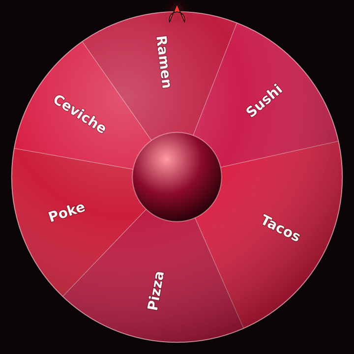

# NeoGlassRojo · Belentani Wheel



**Rueda de decisión neumórfica de cristal rojo.** WebGL2 con degradación a Canvas 2D,
física de giro verificada, resultados reproducibles por semilla y accesibilidad completa.
Cero dependencias en tiempo de ejecución, cero peticiones de red, cero cookies.

> Estado: **verde** — 115 tests, typecheck estricto, ESLint sin avisos, shaders compilados
> con `glslangValidator`, 18,8 KB gzip totales.

---

## Por qué existe

Las ruedas de decisión al uso esconden tres trampas: el resultado no coincide con lo que se
ve, la animación miente con un `Math.random()` decorativo y la interfaz es inaccesible por
teclado. Esta implementación ataca las tres:

| Trampa habitual                                | Cómo se resuelve aquí                                                                                             |
| ---------------------------------------------- | ----------------------------------------------------------------------------------------------------------------- |
| "Ganó X" pero bajo el puntero hay Y            | `planSpin()` **verifica** con `indexAtAngle()` antes de emitir el plan; si falla, cae al centro exacto del sector |
| Pesos decorativos que no afectan al azar       | Un solo `pickWeighted()` puro, auditado con 20 000 giros y desviación en sigmas                                   |
| Animación que sigue corriendo en segundo plano | Un único `requestAnimationFrame`, cancelado al ocultar la pestaña y al terminar                                   |
| Texto invisible o invertido en la rueda        | Etiquetas en capa 2D con volteo por hemisferio y recorte por presupuesto de arco                                  |
| Inaccesible sin ratón                          | `<canvas role="img">` descrito, `aria-live` para el resultado, teclado completo, `prefers-reduced-motion`         |

## Arranque rápido

```bash
npm install
npm run dev        # http://localhost:5173
npm run verify     # typecheck + lint + shaders + tests con cobertura + build + informe
```

Requiere **Node ≥ 22.12**.

## Atajos

| Tecla     | Acción                                                 |
| --------- | ------------------------------------------------------ |
| `Espacio` | Girar                                                  |
| `←` / `→` | Recorrer las opciones sin girar                        |
| `Tab`     | Navegar por presets, alta de opciones, pesos y borrado |

El resultado se anuncia en una región `aria-live="polite"`; la rueda expone una descripción
textual con las opciones y sus probabilidades.

## Arquitectura

```
src/
├── core/                 # Núcleo puro: sin DOM, sin WebGL, 100 % testeable
│   ├── types.ts          # Contratos inmutables del dominio
│   ├── random.ts         # xmur3 + mulberry32 y muestreo ponderado
│   ├── wheel.ts          # Geometría: normalización, layout, índice bajo el puntero
│   ├── easing.ts         # Curvas de desaceleración con derivada verificada
│   ├── spin.ts           # Planificación del giro + autoverificación del resultado
│   ├── store.ts          # Store observable con snapshots congelados
│   ├── theme.ts          # Paleta de cristal rojo con contraste AA garantizado
│   └── presets.ts        # Catálogo de ruedas listas
├── ui/
│   ├── shaders.ts        # GLSL ES 3.00 propio (sectores, bisel, especular, dithering)
│   ├── renderer.ts       # Renderer WebGL2 + renderer Canvas 2D + degradación
│   ├── labels.ts         # Etiquetas 2D compartidas por ambos renderers
│   ├── wheel-controller.ts # Bucle rAF, visibilidad, reduced-motion
│   └── dom.ts            # Helpers tipados de DOM y formato es-ES
├── styles/main.css       # Tokens → reset → cristal → layout → componentes → a11y
└── main.ts               # Cableado de UI: presets, edición, historial, teclado
```

**Decisiones de diseño**

- **El cuerpo en GPU, el texto en 2D.** Un único triángulo sin buffers (`gl_VertexID`) calcula
  el cristal por fragmento en coordenadas polares: sin texturas, sin atlas, nitidez perfecta a
  cualquier DPR. El texto se rasteriza aparte por legibilidad subpíxel.
- **Degradación en cascada.** WebGL2 → Canvas 2D → texto descriptivo. `createRenderer()` captura
  cualquier fallo (contexto, compilación, driver) y no deja nunca una rueda vacía.
- **Semilla en la URL.** `#seed=demo&preset=comer` reproduce un giro exacto: sirve para depurar,
  para compartir un resultado y para que la CLI audite lo mismo que verá el usuario.
- **Una sola fuente de verdad.** La geometría de las etiquetas vive en `labels.ts` y la consume
  también `scripts/preview.mjs`, así el PNG de documentación no puede desviarse de la app.

## Herramientas internas

```bash
npm run wheel -- --help                       # girar desde la terminal (determinista)
npm run wheel -- -l "Sí,No,Quizá" -w "1,1,.5" -n 20 --json
npm run preview -- --help                     # PNG de la rueda con la geometría real
npm run preview -- --preset dev --rotation=-20 --out docs/preview-dev.png
npm run check:shaders                         # compila el GLSL con glslangValidator
npm run report                                # presupuesto de tamaño + auditoría estadística
```

`npm run report` falla con código 1 si el bundle excede presupuesto o si la distribución de
resultados se desvía **≥ 3σ** de los pesos declarados.

## Presupuesto de rendimiento

| Artefacto  |   Crudo |        Gzip | Límite |
| ---------- | ------: | ----------: | -----: |
| JS inicial | 28,7 KB | **11,2 KB** |  60 KB |
| CSS        | 17,1 KB |  **4,8 KB** |  25 KB |
| HTML       |  7,8 KB |  **2,5 KB** |  12 KB |
| **Total**  |       — | **18,8 KB** | 120 KB |

Sin fuentes externas, sin CDN, sin dependencias de ejecución: un solo documento y dos assets.

## Calidad

```bash
npm run test:coverage   # 115 tests · 97,9 % líneas · 100 % funciones
npm run lint            # ESLint 10 + typescript-eslint estricto con tipos
npm run format:check    # Prettier
npm run check:shaders   # GLSL compilado por el validador de Khronos
```

La suite cubre la matemática del giro (verificación de 500 giros aleatorios), la estadística de
los pesos, el contraste WCAG de toda la paleta, el store observable, el bucle de animación con
reloj simulado (incluida la pausa por pestaña oculta) y un **E2E del camino feliz** que ejecuta
el bundle real dentro de JSDOM sobre el `index.html` de producción.

## Accesibilidad

- Estructura semántica: `header`/`main`/`footer`, un solo `h1`, enlace de salto.
- Todo control tiene nombre accesible; los inputs tienen `label` o `aria-label`.
- Contraste AA (≥ 4,5:1) **verificado por test** en los 24 colores de la paleta.
- `prefers-reduced-motion` acorta el giro a 700 ms y lo reduce a una vuelta sin desvío.
- `prefers-contrast: more`, `forced-colors` y `print` tienen estilos propios.

## Compatibilidad

| Navegador                                     | Render                                        |
| --------------------------------------------- | --------------------------------------------- |
| Chrome/Edge 100+, Firefox 100+, Safari 16+    | WebGL2 (shader propio)                        |
| Navegadores sin WebGL2 o con driver bloqueado | Canvas 2D                                     |
| Sin JS                                        | Contenido del documento (estructura y textos) |

## Licencia

MIT · NeoGlassRojo · Belentani Wheel
